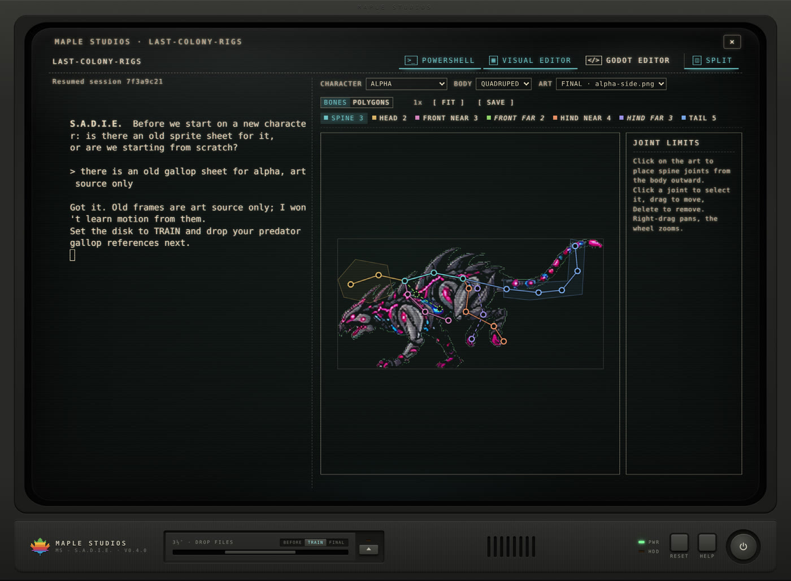
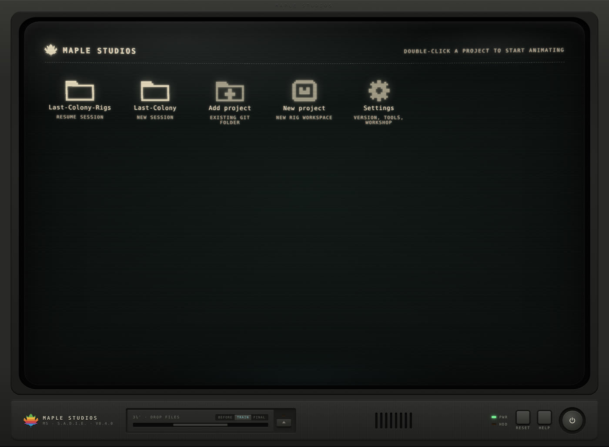

# S.A.D.I.E.

**Sprite Animation, Deformation & In-betweening Editor**

S.A.D.I.E. is an AI animation workstation for pixel-art characters, built on Claude Code. She runs on the same game-dev architecture as [Maple Studios](https://github.com/jddominick/Maple-Studios), and she goes further. She has advanced memory and learning, a bigger toolbox, and an upgraded retro-computer interface.

Give her motion references and character art. She builds an editable rig, animates it with you frame by frame, and exports approved frames that Maple can drop straight into your game.

This repo hosts the installer and updates only. The source is private.

## What she can do

- **Remember and learn.** Every project keeps its own memory of the work, and she keeps a long-term archive across sessions. Say "teach agent" to show her a new tool or a better way of working. She tries it, checks in later on whether it helped, and only then adds it to her Personality Matrix for good. For a proper lesson, open her **Workshop** in Settings.
- **Turn references into motion.** Drop videos, GIFs or sprite sheets on the floppy drive. She files them in an intake library, splits sheets into frames, and studies the motion. The disk's **BEFORE / TRAIN / FINAL** switch tells her whether you're handing her old art, training material or final art.
- **Rig in the Visual Editor.** Place bones, draw polygons and set joint limits on your character, all saved as a rig file in your project. Open the **Godot Editor** beside it, or use **Split** view to talk to her and watch the rig at the same time.
- **Use real tools.** Godot, Git and Claude Code are installed for you, with ffmpeg, yt-dlp, GitHub CLI, ImageMagick, GIMP and TexturePacker as optional extras.
- **Look the part.** You get a CRT desktop with a glass tube, a hardware panel and a floppy tray, plus a boot intro where she introduces herself. A slow scan band rolls by now and then. If you'd rather keep things still, turn on **Reduce motion** in Settings.

## Install on Windows

1. Download **S.A.D.I.E-Setup-x.y.z.exe** from [Releases](../../releases/latest) and run it. No admin rights needed.
   Windows may show "Windows protected your PC" because the installer isn't code-signed. Click **More info → Run anyway**.
2. Start S.A.D.I.E. from the desktop shortcut. On first start she shows her **starter pack**, which installs Godot, Claude Code and Git if they're missing, plus the extras you leave ticked. Already have a tool somewhere unusual? Click **Locate…** next to it.
3. Use **Add project** on an existing rig project's git folder, or **New project** to make a fresh rig workspace in `Documents\Animation Projects`.
4. The first time, Claude Code asks you to sign in with a Claude account (Pro or Max) or paste an Anthropic API key.

Requires Windows 10 or 11, 64-bit.

## Install on a Mac

1. Download **S.A.D.I.E-x.y.z-mac.dmg** from [Releases](../../releases/latest) (Apple silicon and Intel, macOS 12 or newer).
2. Open the .dmg and drag **S.A.D.I.E** into **Applications**.
3. The first time, macOS blocks it because it isn't signed by an Apple developer. Press **Done**, then **System Settings → Privacy & Security → Open Anyway**. You only do this once.

## Updates

Every time she boots, S.A.D.I.E. checks for a new version and asks: **[Y] INSTALL UPDATE** or **[N] LATER**. Your projects, sessions and memory are kept. On a Mac, **Y** opens the download page: drag the new app into Applications and choose **Replace**.

Upgrading from an early version called Animation Studio? Install S.A.D.I.E. as above and your projects come with you. On a Mac, move the old Animation Studio app to the Trash afterwards.

## Uninstall

Windows: **Settings → Apps → S.A.D.I.E → Uninstall**. On a Mac, drag the app to the Trash.

Your data stays until you delete it. It lives in `%APPDATA%\Animation Studio` on Windows and `~/Library/Application Support/Animation Studio` on a Mac. The folder keeps its original name so updates never lose your work.
